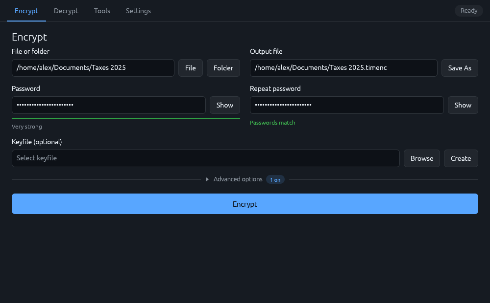

# TimENC

TimENC encrypts files and folders with a password (and optionally a keyfile).
It is written in Rust, has a small native GUI and a command-line tool, and runs
on Windows, macOS and Linux.



Under the hood: **ChaCha20-Poly1305** for encryption and **Argon2id** to turn
your password into a key. There is no public-key crypto anywhere, so there is
nothing for a quantum computer to break with Shor's algorithm (more on that
below).

**Want to try and break it?** See [SECURITY.md](SECURITY.md) for what is in
scope, the threat model, and how to report something.

## What it does

* Encrypts a file or a whole folder into one `.timenc` file
* Password, or password + keyfile
* File name and folder structure are encrypted too
* Any change to the file (flipped bits, cut-off end, reordered or appended
  chunks) is detected and decryption fails
* A file only opens with exactly one password: the header contains a key
  commitment, so a wrong password is rejected before any decryption happens
* Optional zstd compression, optional padding to hide the exact file size
* Two key-derivation strengths: `balanced` (256 MB RAM) and `paranoid` (1 GB)
* Safe handling of untrusted archives: no path traversal, no hard links, devices
  or FIFOs, and nothing is written through a symlink the archive planted
* Never overwrites an existing file, and never leaves a half-written `.timenc`
  behind
* Your original is only deleted if you ask for it, and only after the new file
  was written to disk and decrypted again to check it
* No unencrypted temp copies when encrypting: folders and compressed data are
  streamed straight into the encryptor
* Passwords and keys are wiped from memory after use

## Download

Releases for every platform are here:
**https://github.com/SnowTimSwiss/TimENC/releases/latest**

* Windows: installer or portable `.exe`
* macOS: `.dmg`
* Linux: `.AppImage`, `.deb`, `.rpm` or `.flatpak`

## Command line

```bash
# Asks for the password (twice when encrypting)
timenc encrypt secret.pdf -o secret.timenc
timenc decrypt secret.timenc -o ./out

# Without a terminal: read the password from the first line of a file
timenc encrypt photos/ -o photos.timenc --password-file ~/.timenc-pass --compress

# Make a keyfile, then use it
timenc generate-keyfile my.key
timenc encrypt secret.pdf -o secret.timenc -k my.key
```

| Command | What it does |
|---------|--------------|
| `encrypt <input> -o <output>` | Encrypt a file or folder. The output must not exist yet. |
| `decrypt <input> -o <folder>` | Decrypt a `.timenc` file into a folder |
| `generate-keyfile <output>` | Write 32 random bytes to a new keyfile (mode `0600` on Unix) |

| Option | What it does |
|--------|--------------|
| `-o, --output` | Output file (encrypt) or folder (decrypt) |
| `--password-file <path>` | Read the password from the first line of a file |
| `-p, --password` | Password on the command line. Insecure: it shows up in the process list and your shell history. |
| `-k, --keyfile` | Use a keyfile as well |
| `-c, --compress` | Compress with zstd first (encrypt only) |
| `--pad` | Hide the exact size, at most about 12% bigger (encrypt only) |
| `--kdf-profile` | `balanced` (default) or `paranoid` (encrypt only) |
| `--delete-source` | Delete the input afterwards. Off by default. When encrypting, the new file is verified first. |
| `-h`, `-V` | Help, version |

`TIMENC_THREADS=<n>` limits the number of worker threads (default: all cores,
at most 8).

## The GUI

Drawn with [egui](https://github.com/emilk/egui): no embedded browser, about
12 MB, no CPU use while idle.

* Drag & drop, native file dialogs
* Password strength indicator and a repeat field, so a typo can't lock you out
* Built-in keyfile generator
* Follows the system light/dark setting
* Double-clicking a `.timenc` file opens it in TimENC (on Linux it goes to the
  window that is already open)
* English and German

## How it works

1. A folder is packed as a TAR stream (symlinks are stored as links, never
   followed). If you chose compression, the stream goes through zstd.
2. Argon2id turns the password (plus keyfile, if any) into a master key. That
   is split with keyed BLAKE2b into three subkeys: one for the metadata, one
   for the data, one for the key commitment.
3. The commitment goes into the header. On decryption it is checked first, so a
   wrong password fails right after key derivation.
4. The metadata (name, folder flag, compression flag, true length) is encrypted
   under its own key.
5. The data is encrypted in 64 KiB chunks. Every chunk authenticates the whole
   header, its own position, and whether it is the last chunk. That is what
   catches truncation, reordering, duplication and appended data.
6. Decryption writes the plaintext to a temporary file next to the output
   first, and only moves it into place once the whole stream has been
   authenticated.

Because every file gets its own subkeys, chunk nonces are simple counters. No
random nonces, no nonce reuse.

### Algorithms

| Part | What is used |
|------|--------------|
| Cipher | ChaCha20-Poly1305 (256-bit key, 96-bit nonce, 16-byte tag) |
| Key derivation | Argon2id, parameters stored in the header |
| Subkeys | Keyed BLAKE2b, one per purpose |
| Key commitment | 32-byte BLAKE2b-based tag |
| Padding | Padmé (optional) |
| Keyfile | 32 random bytes, appended to the password before Argon2 |

| Profile | Passes | Memory | Lanes |
|---------|--------|--------|-------|
| `balanced` (default) | 3 | 256 MiB | 4 |
| `paranoid` | 4 | 1 GiB | 4 |

The profile is recorded in the header, so old files keep opening whatever you
choose later. When reading a file, the parameters are range-checked (8 MiB to
4 GiB, 1 to 64 passes) so a crafted header can't make TimENC allocate
unbounded memory.

### Quantum computers

There is no RSA, Diffie-Hellman or signature scheme in TimENC, which are the
things Shor's algorithm breaks. What is left is symmetric:

* ChaCha20 with a 256-bit key: Grover's algorithm cuts that to about 128 bits
  of security, which is still out of reach.
* Argon2id is memory-hard, so a quantum computer gains almost nothing against
  it.
* Poly1305 and BLAKE2b are unaffected as well.

If TimENC ever gets public-key features (encrypting for someone else's key),
they will use a hybrid of X25519 and ML-KEM, never post-quantum alone.

### File format (v6)

```
Header, 71 bytes, fixed size
├─ Magic "TIMENC"             6
├─ Version 0x06               1
├─ Salt                      16
├─ Argon2 passes (u32 BE)     4
├─ Argon2 memory KiB (u32)    4
├─ Argon2 lanes (u32)         4
├─ Metadata length (u32)      4
└─ Key commitment            32

Encrypted metadata (ciphertext + 16-byte tag)
├─ is_dir          1 byte
├─ name length     u16 BE
├─ name            UTF-8
├─ compressed      1 byte
└─ payload length  u64 BE (before padding)

Data: 64 KiB chunks, each ciphertext + 16-byte tag,
      ended by a chunk marked final (it may be empty)
```

Older files (v3, v4, v4.5) can still be decrypted but not created. They cannot
detect truncation at a chunk boundary, so TimENC warns you when you open one.
Encrypt the result again to upgrade it.

Version byte `0x05` was already taken by the small v4.5 metadata change, so the
first real crypto change after v4 got `0x06` and is simply called v6.

| What changed in v6 | Why |
|--------------------|-----|
| Chunks are numbered and the last one is marked | v4 read until end of file, so cutting a file at a chunk boundary still decrypted, just shorter |
| Key commitment in the header | ChaCha20-Poly1305 alone doesn't commit to its key, so a file could be built that opens under two passwords with different content |
| Separate subkeys per purpose | v4 used one key everywhere. It also means Argon2 now runs once per file instead of twice. |
| Argon2 parameters in the header are used | v4 stored them but ignored them, which made `paranoid` impossible |
| Optional Padmé padding | Otherwise the file size gives away the plaintext size almost exactly |
| No panics on bad input | Header parsing and key derivation return errors; release builds abort on panic |

### Speed

Chunks are processed in batches of 4 MiB across all cores (up to 8), for
ChaCha20-Poly1305 and for zstd. The file format doesn't depend on the thread
count: files from any version open with any other.

Measured on a 4-core cloud VM, data in the page cache, median of several runs,
including about 0.6 s of Argon2id per operation:

| Case | Time |
|------|-----:|
| 1 GiB random file, encrypt | 2.4 s |
| 1 GiB random file, decrypt | 2.3 s |
| 512 MiB text, encrypt with `--compress` | 3.0 s |
| Folder with 20,000 files (320 MiB), encrypt | 1.5 s |
| Folder with 20,000 files (320 MiB), decrypt | 2.0 s |

Much of what remains is the `fsync` before the output is moved into place
(about a second per GiB on that VM). Your disk will matter more than the cipher.

### Safe file handling

* Encryption writes to a temporary file next to the destination, syncs it, and
  only then moves it into place, without replacing anything that already
  exists. A crash never leaves a truncated `.timenc` file.
* With delete-source, the new file is decrypted again and compared to what was
  read. Only if they match is the original overwritten with zeros and removed.
  Overwriting is best effort: SSDs and copy-on-write file systems can keep old
  copies.
* Decryption keeps the `.timenc` file unless you ask otherwise, and syncs the
  output before deleting it.

## Building

You only need a [Rust toolchain](https://rustup.rs/). X11, Wayland and OpenGL
are loaded at run time, so no system packages are needed.

```bash
git clone https://github.com/SnowTimSwiss/TimENC.git
cd TimENC

cargo build --release              # command-line tool
cd gui && cargo run --release      # GUI
```

Packages (`.deb`, `.rpm`, AppImage, `.dmg`, Windows installer, Flatpak) are
built by `.github/workflows/release-build.yml` using the scripts in
`packaging/` and `flatpak/`.

### Tests

```bash
cargo test
cargo clippy --all-targets -- -D warnings
(cd gui && cargo test && cargo clippy --all-targets -- -D warnings)
```

The tests include flipped bytes, truncation at every position, and hostile
archives. Fuzzing and the dependency audit are described in
[SECURITY.md](SECURITY.md).

## License

GPL-3.0, see [LICENSE](LICENSE). You can use, study, modify and share TimENC. If
you distribute a modified version, it has to stay under the GPL with its source
available.
